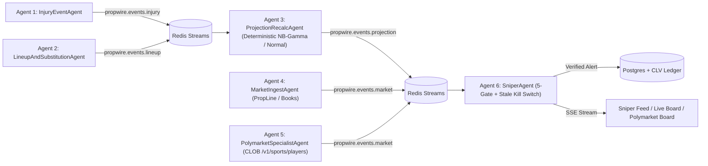

# PropWire Live Agentic Sniper Terminal — Architecture & Contracts

## 1. Architectural Law (Non-Negotiable Invariants)

1. **Deterministic Core Invariant**:
   - The pricing function remains strictly mathematical:
     `price_prop(player_state, market_state, game_state) -> { distribution, fair_prob, edge, kelly_stake }`.
   - NFL uses the calibrated Negative Binomial / Compound Gamma GLM (`src/model.py`, ECE < 1.2%).
   - NBA uses the sport-adapter parameterized distributional engine (`mu`, `sd`, Discrete NB / Poisson-Gamma).
   - **No LLM in the decision path**: LangGraph nodes invoke deterministic pricing functions and never substitute an LLM guess for `fair_prob`, `edge`, or `kelly_stake`.
   - The LLM narrator (`explain_edge`) runs strictly **post-decision** after `fair_prob` and `edge` are locked and persisted.

2. **LangGraph Event Spine with Durable Checkpointing**:
   - Implemented as a `StateGraph(AgentState)` with Postgres persistence (`PostgresSaver` / durable SQLite/Postgres checkpoint fallback when local).
   - The graph routes normalized, SHA-256 receipt-stamped events through deterministic state transitions.

3. **Redis Streams Fan-Out & Postgres Truth**:
   - **Redis Streams** (`XADD` / `XREADGROUP`) handles low-latency fan-out from ingestion agents to compute agents. Durable stream adapter supports native Redis (`REDIS_URL`) with a deterministic persistent WAL stream fallback for zero-dependency test harnesses and local verification.
   - **Postgres** (`DATABASE_URL`, with deterministic SQLite/Postgres dual-driver compatibility for offline CI) stores every `agent_events`, `projections`, `sniper_alerts`, and `clv_ledger` record with `source_hash` and `model_version`.

4. **The Stale Kill Switch**:
   - Every projection and market quote carries `feed_age_seconds = (now_utc - fetched_at).total_seconds()`.
   - If `feed_age_seconds > threshold`, `is_stale = True` is set immediately, `SniperAgent` execution is suppressed, and a structured `STALE_KILL_SWITCH_SUPPRESSED` log + audit event is recorded.

---

## 2. State Schema (`AgentState`)

```python
from datetime import datetime
from typing import Literal, TypedDict
from pydantic import BaseModel, Field


class PropProjection(BaseModel):
    prop_id: str
    sport: Literal["nfl", "nba"]
    game_id: str
    player_id: str
    player_name: str
    team: str
    opponent: str
    market: str
    mu: float
    sd: float
    alpha: float | None = None
    k: float | None = None
    fair_line: float
    fair_prob_over: float
    fair_prob_under: float
    minutes_projection: float | None = None
    usage_rate: float | None = None
    remaining_opportunities: float | None = None
    catalyst_reason: str | None = None  # e.g., "injury_vacancy", "usage_surge", "foul_trouble", "baseline"
    model_version: str = "2026.10.29-nb-gamma-v2"
    source_hash: str
    fetched_at: datetime
    computed_at: datetime
    feed_age_seconds: float
    is_stale: bool = False


class SniperAlert(BaseModel):
    alert_id: str
    prop_id: str
    sport: Literal["nfl", "nba"]
    game_id: str
    player_id: str
    player_name: str
    team: str
    market: str
    side: Literal["OVER", "UNDER", "YES", "NO"]
    line: float
    book: str
    odds_american: int
    fair_line: float
    fair_prob: float
    implied_prob: float
    edge_pct: float
    mispricing_bps: float
    ev_per_unit: float
    kelly_stake: float
    confidence_score: float
    liquidity_score: float
    clv_expectation: float
    feed_age_seconds: float
    is_stale: bool
    deep_link: str
    catalyst_reason: str
    reasoning_chain: str = ""
    source_hash: str
    model_version: str
    created_at: datetime


class AgentState(TypedDict):
    event_type: Literal["injury", "lineup", "substitution", "foul", "market_move", "game_clock"]
    event_payload: dict
    affected_player_ids: list[str]
    affected_game_id: str
    source_hash: str
    fetched_at: datetime
    is_stale: bool
    projections: dict[str, PropProjection]  # keyed by prop_id
    alerts: list[SniperAlert]
```

---

## 3. Redis Stream Topic Topology

| Stream Topic | Producer Agent | Consumer Group / Agent | Payload Contract |
|---|---|---|---|
| `propwire.events.injury` | `InjuryEventAgent` | `cg_recalc` -> `ProjectionRecalcAgent` | `InjuryEventPayload` (player_id, team, status, body_part, vacated_minutes, vacated_targets, beneficiaries, source_hash, fetched_at) |
| `propwire.events.lineup` | `LineupAndSubstitutionAgent` | `cg_recalc` -> `ProjectionRecalcAgent` | `LineupEventPayload` (game_id, player_id, sub_type: `substitution` \| `foul_trouble` \| `confirmed_starter`, personal_fouls, quarter, clock, minutes_delta, usage_delta, source_hash, fetched_at) |
| `propwire.events.market` | `MarketIngestAgent`, `PolymarketSpecialistAgent` | `cg_sniper` -> `SniperAgent` | `MarketMovePayload` (prop_id, player_id, book, market, line, over_odds, under_odds, implied_prob, liquidity_score, token_id, deep_link, source_hash, fetched_at) |
| `propwire.events.projection` | `ProjectionRecalcAgent` | `cg_sniper` -> `SniperAgent` | `PropProjection` (full distribution parameters, fair_line, fair_prob_over, catalyst_reason, feed_age_seconds, source_hash) |
| `propwire.events.sniper` | `SniperAgent` | `cg_sse` -> FastAPI SSE Stream (`/api/sniper/stream`) | `SniperAlert` or `SniperSuppressionEvent` (honest suppression audit log) |

---

## 4. Stale Kill Switch Thresholds

| Feed Class | Live In-Game Threshold (`max_age_seconds`) | Pregame Threshold (`max_age_seconds`) | Action on Breach |
|---|---|---|---|
| **Injury / Availability Feed** | **90s** | **300s** | Set `is_stale = True`, block `SniperAgent`, emit `STALE_INJURY_FEED` suppression log |
| **Lineup / Play-by-Play Feed** | **45s** | **300s** | Set `is_stale = True`, block live remaining-game recalc alert firing |
| **Sportsbook Odds / PropLine** | **20s** | **60s** | Set `is_stale = True`, block `SniperAgent`, emit `STALE_ODDS_FEED` suppression log |
| **Polymarket CLOB Orderbook** | **20s** | **60s** | Set `is_stale = True`, block `SniperAgent`, mark Polymarket row `VERIFY_LIQUIDITY` |

---

## 5. Postgres DDL Schema

```sql
-- 1. Immutable Audit Log of Every External Event & Agent Transition
CREATE TABLE IF NOT EXISTS agent_events (
    event_id VARCHAR(64) PRIMARY KEY,
    stream_topic VARCHAR(64) NOT NULL,
    agent_name VARCHAR(64) NOT NULL,
    event_type VARCHAR(32) NOT NULL,
    sport VARCHAR(16) NOT NULL DEFAULT 'nfl',
    affected_game_id VARCHAR(64) NOT NULL,
    affected_player_ids JSONB NOT NULL DEFAULT '[]',
    dedup_key VARCHAR(64) NOT NULL,
    event_payload JSONB NOT NULL,
    source_hash CHAR(64) NOT NULL,
    model_version VARCHAR(32) NOT NULL,
    fetched_at TIMESTAMPTZ NOT NULL,
    processed_at TIMESTAMPTZ NOT NULL DEFAULT NOW(),
    feed_age_seconds DOUBLE PRECISION NOT NULL,
    is_stale BOOLEAN NOT NULL DEFAULT FALSE,
    decision VARCHAR(32) NOT NULL,
    reason TEXT NOT NULL
);

CREATE INDEX IF NOT EXISTS idx_agent_events_game ON agent_events(affected_game_id, processed_at DESC);
CREATE INDEX IF NOT EXISTS idx_agent_events_dedup ON agent_events(dedup_key);

-- 2. Live & Pregame Distributional Projections
CREATE TABLE IF NOT EXISTS projections (
    prop_id VARCHAR(128) PRIMARY KEY,
    sport VARCHAR(16) NOT NULL,
    game_id VARCHAR(64) NOT NULL,
    player_id VARCHAR(64) NOT NULL,
    player_name VARCHAR(128) NOT NULL,
    team VARCHAR(16) NOT NULL,
    opponent VARCHAR(16) NOT NULL,
    market VARCHAR(32) NOT NULL,
    mu DOUBLE PRECISION NOT NULL,
    sd DOUBLE PRECISION NOT NULL,
    alpha DOUBLE PRECISION,
    k DOUBLE PRECISION,
    fair_line DOUBLE PRECISION NOT NULL,
    fair_prob_over DOUBLE PRECISION NOT NULL,
    fair_prob_under DOUBLE PRECISION NOT NULL,
    minutes_projection DOUBLE PRECISION,
    usage_rate DOUBLE PRECISION,
    remaining_opportunities DOUBLE PRECISION,
    catalyst_reason VARCHAR(64) NOT NULL DEFAULT 'baseline',
    source_hash CHAR(64) NOT NULL,
    model_version VARCHAR(32) NOT NULL,
    fetched_at TIMESTAMPTZ NOT NULL,
    computed_at TIMESTAMPTZ NOT NULL DEFAULT NOW(),
    feed_age_seconds DOUBLE PRECISION NOT NULL,
    is_stale BOOLEAN NOT NULL DEFAULT FALSE
);

CREATE INDEX IF NOT EXISTS idx_projections_game_player ON projections(game_id, player_id);

-- 3. Qualified Sniper Alerts (Executable & Auditable)
CREATE TABLE IF NOT EXISTS sniper_alerts (
    alert_id VARCHAR(64) PRIMARY KEY,
    prop_id VARCHAR(128) NOT NULL,
    sport VARCHAR(16) NOT NULL,
    game_id VARCHAR(64) NOT NULL,
    player_id VARCHAR(64) NOT NULL,
    player_name VARCHAR(128) NOT NULL,
    team VARCHAR(16) NOT NULL,
    market VARCHAR(32) NOT NULL,
    side VARCHAR(16) NOT NULL,
    line DOUBLE PRECISION NOT NULL,
    book VARCHAR(64) NOT NULL,
    odds_american INTEGER NOT NULL,
    fair_line DOUBLE PRECISION NOT NULL,
    fair_prob DOUBLE PRECISION NOT NULL,
    implied_prob DOUBLE PRECISION NOT NULL,
    edge_pct DOUBLE PRECISION NOT NULL,
    mispricing_bps DOUBLE PRECISION NOT NULL,
    ev_per_unit DOUBLE PRECISION NOT NULL,
    kelly_stake DOUBLE PRECISION NOT NULL,
    confidence_score DOUBLE PRECISION NOT NULL,
    liquidity_score DOUBLE PRECISION NOT NULL,
    clv_expectation DOUBLE PRECISION NOT NULL,
    feed_age_seconds DOUBLE PRECISION NOT NULL,
    is_stale BOOLEAN NOT NULL DEFAULT FALSE,
    deep_link TEXT NOT NULL,
    catalyst_reason VARCHAR(64) NOT NULL,
    reasoning_chain TEXT NOT NULL DEFAULT '',
    source_hash CHAR(64) NOT NULL,
    model_version VARCHAR(32) NOT NULL,
    created_at TIMESTAMPTZ NOT NULL DEFAULT NOW()
);

CREATE INDEX IF NOT EXISTS idx_sniper_alerts_created ON sniper_alerts(created_at DESC);
CREATE INDEX IF NOT EXISTS idx_sniper_alerts_sport ON sniper_alerts(sport, created_at DESC);

-- 4. Cryptographic CLV Ledger (Sportsbooks + Polymarket Fills)
CREATE TABLE IF NOT EXISTS clv_ledger (
    ledger_id VARCHAR(64) PRIMARY KEY,
    alert_id VARCHAR(64),
    sport VARCHAR(16) NOT NULL,
    game_id VARCHAR(64) NOT NULL,
    player_id VARCHAR(64) NOT NULL,
    player_name VARCHAR(128) NOT NULL,
    team VARCHAR(16) NOT NULL,
    market VARCHAR(32) NOT NULL,
    side VARCHAR(16) NOT NULL,
    venue_type VARCHAR(32) NOT NULL DEFAULT 'sportsbook', -- 'sportsbook' | 'polymarket'
    book VARCHAR(64) NOT NULL,
    entry_line DOUBLE PRECISION NOT NULL,
    entry_odds INTEGER NOT NULL,
    entry_implied_prob DOUBLE PRECISION NOT NULL,
    fair_prob_at_entry DOUBLE PRECISION NOT NULL,
    edge_pct_at_entry DOUBLE PRECISION NOT NULL,
    kelly_stake DOUBLE PRECISION NOT NULL,
    closing_line DOUBLE PRECISION,
    closing_odds INTEGER,
    closing_implied_prob DOUBLE PRECISION,
    clv_prob_delta DOUBLE PRECISION,
    clv_bps DOUBLE PRECISION,
    actual_stat DOUBLE PRECISION,
    outcome VARCHAR(16), -- 'WIN' | 'LOSS' | 'PUSH' | 'PENDING'
    source_hash CHAR(64) NOT NULL,
    receipt_hash CHAR(64) NOT NULL,
    model_version VARCHAR(32) NOT NULL,
    logged_at TIMESTAMPTZ NOT NULL DEFAULT NOW(),
    closed_at TIMESTAMPTZ,
    settled_at TIMESTAMPTZ
);

CREATE INDEX IF NOT EXISTS idx_clv_ledger_sport ON clv_ledger(sport, logged_at DESC);

-- 5. LangGraph State Checkpoints
CREATE TABLE IF NOT EXISTS langgraph_checkpoints (
    thread_id VARCHAR(128) NOT NULL,
    checkpoint_id VARCHAR(128) NOT NULL,
    parent_checkpoint_id VARCHAR(128),
    state_json JSONB NOT NULL,
    source_hash CHAR(64) NOT NULL,
    created_at TIMESTAMPTZ NOT NULL DEFAULT NOW(),
    PRIMARY KEY (thread_id, checkpoint_id)
);
```

---

## 6. Agent Execution Pipeline & Gate Specification


